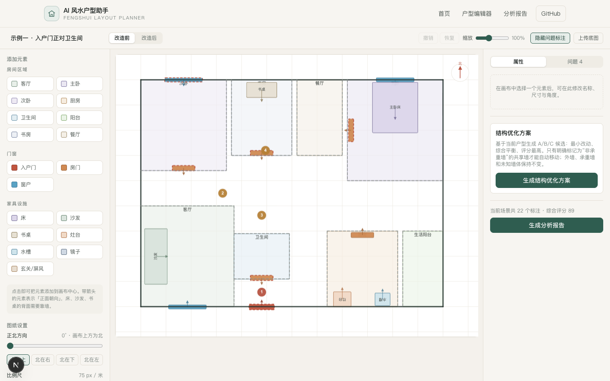
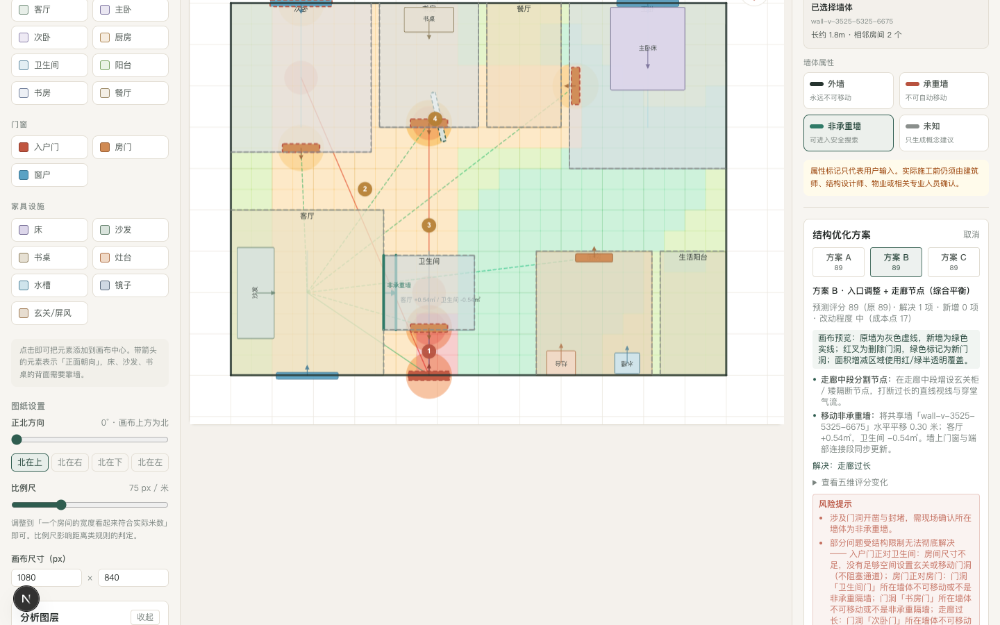
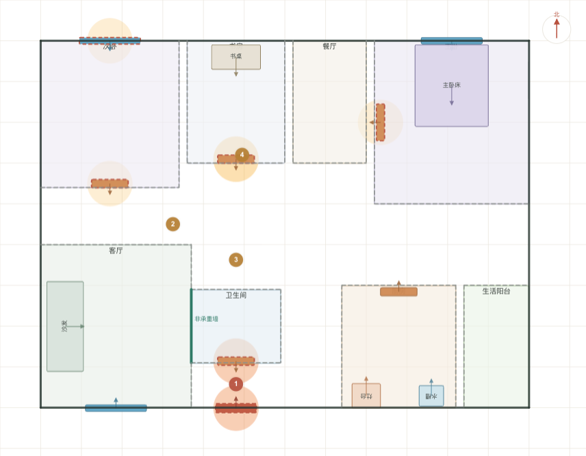
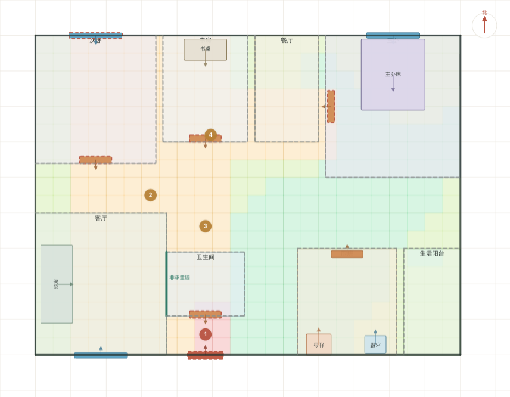
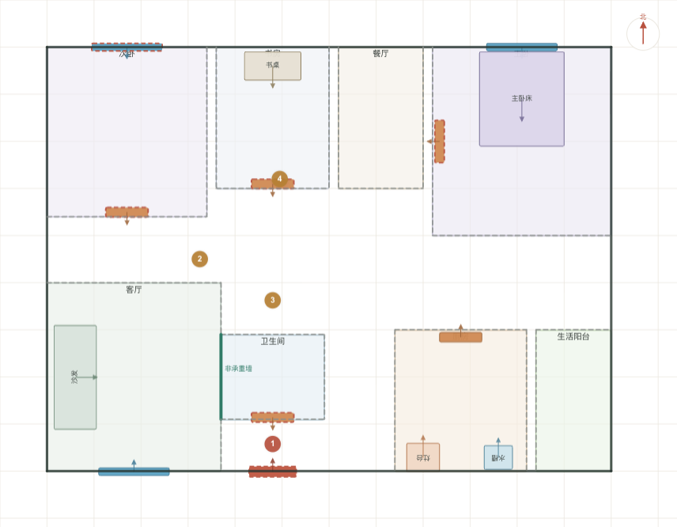
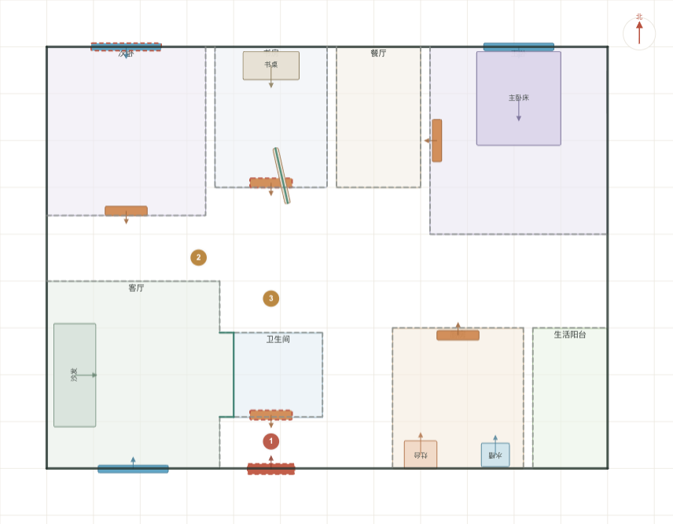
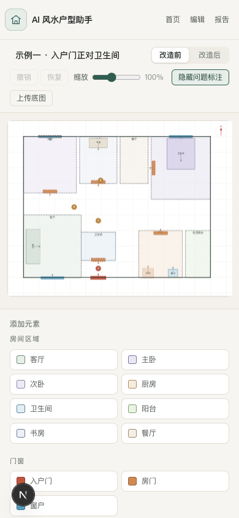

# AI 风水户型助手 · FengShui Layout Planner

> FengShui Layout Planner 是一个结合**传统住宅布局规则**与**现代空间设计原则**的可解释户型分析与优化工具。它通过固定规则、几何约束和可追溯评分帮助用户理解布局问题、比较候选方案，不使用随机“AI 分数”。
>
> 产品定位：**传统居住文化与现代空间布局参考工具**，不是算命网站，也不是施工设计软件。

[在线演示](https://fengshui-layout-planner.vercel.app) · [English documentation](./README.en.md)


---

## 目录

- [项目定位](#项目定位)
- [功能特性](#功能特性)
- [产品截图](#产品截图)
- [Structural Optimization](#structural-optimization)
- [快速开始](#快速开始)
- [内置示例户型](#内置示例户型)
- [使用流程](#使用流程)
- [目录结构](#目录结构)
- [架构：确定性规则引擎](#架构确定性规则引擎)
- [评分系统（五维）](#评分系统五维)
- [规则总览（18 条）](#规则总览18-条)
- [当前边界](#当前边界)
- [技术栈](#技术栈)
- [可扩展路线](#可扩展路线)
- [贡献](#贡献)
- [许可证](#许可证)
- [免责声明](#免责声明)

---

## 项目定位

| 项目 | 说明 |
| --- | --- |
| 中文名 | AI 风水户型助手 |
| 英文名 | FengShui Layout Planner |
| 类型 | 纯前端户型布局分析工具 |
| 运行方式 | Next.js + 浏览器，数据保存在本地（localStorage） |
| 核心约束 | 评分必须由固定规则引擎计算，**不依赖大模型随机评分** |

核心能力：

- **18 条确定性规则**：相同输入永远得到相同结果，每条问题提供传统解释、现代解释和整改依据。
- **五维评分**：传统风水、空间动线、私密程度、功能布局、采光通风，支持扣分追溯和 high 问题上限。
- **户型可视化编辑**：上传 JPG/PNG 或使用三个示例；标记房间、门窗、家具与屏风，支持拖动、缩放、旋转、改名、删除和撤销恢复。
- **7 个分析图层**：热力、隐私视线、气流、生活动线、采光、动静分区和阳宅空间能量示意，可独立开关并查看计算依据。
- **家具与门洞优化**：确定性调整家具、门洞错位、封闭旧门洞及玄关 / 屏风候选。
- **非承重墙结构优化**：真实移动已确认的共享 partition wall，同步两侧房间 polygon、面积及门窗。
- **A/B/C 候选方案**：A 最小改动、B 综合平衡、C 评分最高；显示解决 / 新增问题、成本和具体结构差异。
- **before / after**：候选先预览、确认后写入改造场景，应用与撤销均为完整 Scenario 原子操作。
- **本地隐私设计**：纯前端运行，无账号、无后端、无付费 API；项目数据保存在浏览器 localStorage。

---

## 功能特性

- **确定性分析**：同一户型、相同标记，永远得到相同评分。规则为纯函数，无随机数、无时间、无网络依赖。
- **五维评分**：传统风水、空间动线、私密程度、功能布局、采光通风，各 100 分起评，等权合成总分。
- **18 种可标记元素**：客厅、主卧、次卧、厨房、卫生间、阳台、书房、餐厅、入户门、房门、窗户、床、沙发、书桌、灶台、水槽、镜子、玄关 / 屏风。
- **图上标注**：按严重程度着色的问题标记，点击可在图文中定位。
- **改造对比**：`before` / `after` 双场景，可复制场景后逐项整改再对比评分变化。
- **结构候选**：A 最小改动、B 综合平衡、C 评分最高；支持轴对齐共享非承重墙平移，并同步墙两侧 room polygon、面积、几何中心及依附门窗。展示墙移动距离、房间面积变化、门洞变化、解决 / 新增问题、约束原因、预测分和改动成本。候选不会覆盖原始方案。
- **七个分析图层**：问题热力、隐私视线、气流路径、生活动线、采光潜力、动静分区、阳宅空间能量示意；能量图明确为传统文化可视化模型，非物理能量测量。
- **本地持久化**：项目、当前场景、候选预览和图层状态保存在浏览器 localStorage；schema v3 会迁移旧数据，并把旧版推断的可移动墙安全降级为 `unknown`，损坏数据会恢复为空状态。
- **上传保护**：只接受 JPG/PNG，单文件不超过 12 MB、4000 万像素；大图会压缩到最长边 1600px。
- **零配置起步**：第一版无需数据库、不强制 AI API、不需要配置任何 Key。
- **响应式**：首页、报告和编辑器适配电脑 / 平板 / 手机；手机端复杂图层面板默认折叠。

---

## 产品截图

以下截图由当前 v1.0.0 代码通过 Playwright 在真实 Chrome 中生成。

### 户型编辑器与 A/B/C 自动优化

| 可视化编辑器 | A/B/C 候选与结构预览 |
| --- | --- |
|  |  |

### 确定性分析图层

| 风水问题热力图 | 阳宅空间能量示意图 |
| --- | --- |
|  |  |

> 阳宅空间能量示意图属于**传统文化可视化模型，非物理能量测量**。

### 非承重墙移动 before / after

| Before · 原始共享墙 | After · 应用结构候选后 |
| --- | --- |
|  |  |

### 移动端



---

## Structural Optimization

用户可以点击墙段并设置墙体属性：

| 属性 | 自动优化行为 |
| --- | --- |
| `Exterior` | 外墙，永远不可自动移动 |
| `Load-bearing` | 承重墙，永远不可自动移动 |
| `Partition` | 已确认的非承重墙，可进入安全搜索 |
| `Unknown` | 未知墙，只提供概念建议，不自动移动 |

只有用户明确标记为 `Partition` 的墙体才能被自动优化器移动。结构优化会：

- 移动两侧都有房间的共享非承重墙；
- 同步调整相邻房间的 `Point[]` polygon、面积、几何中心与包围盒；
- 保持依附墙体的门窗同步，封闭旧门洞并显示新门洞；
- 检查最小面积 / 宽度、polygon 自交 / 重叠、门窗依附、湿区位置与主要房间可达性；
- 重新运行 18 条规则、五维评分和 7 个图层；
- 生成具有真实差异的 A/B/C 候选，并在用户确认前只显示预览。

结构候选是概念级空间方案，不是施工图。

---

## 快速开始

环境要求：**Node.js ≥ 20.9**，**npm ≥ 10**。

```bash
# 1. 按 lockfile 安装依赖
npm ci

# 2. 启动开发服务器（默认 http://localhost:3000）
npm run dev

# 3. 代码检查
npm run lint

# 4. 类型检查
npm run typecheck

# 5. 运行测试
npm run test

# 6. 真实浏览器端到端测试（系统 Chrome）
npm run test:e2e

# 7. 生产构建
npm run build

# 8. 使用 next start 验证生产构建
npm run test:e2e:prod

# 9. 预览生产构建
npm run start

# 只有显式执行此命令才会更新 README 产品截图
npm run screenshots:update
```

---

## 内置示例户型

无需上传图片即可体验完整流程（首页点击「载入示例」）：

| 示例 ID | 名称 | 演示要点 |
| --- | --- | --- |
| `entry-facing-bathroom` | 入户门正对卫生间 | 入户视线与动线问题、隐私 |
| `bathroom-in-center` | 卫生间位于住宅中心 | 中心污位、采光通风 |
| `bed-facing-door` | 床正对门且家具不合理 | 床对门、床头无靠墙、镜子对床 |

---

## 使用流程

1. **上传 / 载入**：在首页上传户型图，或一键载入示例户型。
2. **设置基准**：设置正北方向（罗盘参考）、入户门位置、比例尺（像素 ↔ 米）。
3. **标记元素**：从元素面板添加房间 / 门窗 / 家具，拖动到正确位置，按需缩放、旋转、改名。
4. **确认墙体属性**：点击墙段设置外墙 / 承重墙 / 非承重墙 / 未知；没有可靠资料时保持“未知”。
5. **规则检测**：切换至报告页，规则引擎自动计算评分并列出问题。
6. **定位与优化**：查看问题标注和七个分析图层；生成 A/B/C 候选并先预览原墙、新墙、门洞和面积增减。
7. **确认与撤销**：可行候选只在用户确认后写入 `after`，应用 / 撤销 / 恢复均按完整场景原子处理。
8. **改造对比**：切换 before / after，对比规则结果、五维评分和图层重算结果。
9. **导出报告**：打印或保存分析报告。

---

## 目录结构

```
fengshui-layout-planner/
├── src/
│   ├── app/                      # Next.js App Router 路由
│   │   ├── layout.tsx            # 根布局（站点头/尾、元信息）
│   │   ├── page.tsx              # 首页（介绍/功能/步骤/规则总览/风险声明）
│   │   ├── editor/page.tsx       # 编辑器页（画布+面板+工具条）
│   │   ├── report/page.tsx       # 报告页（评分+问题+预览+对比）
│   │   └── globals.css           # 主题色板与打印样式
│   ├── components/
│   │   ├── site/                 # SiteHeader / SiteFooter
│   │   ├── home/                 # StartPanel（上传/示例入口）
│   │   ├── editor/               # 编辑画布 / 图层面板 / 候选面板 / 工具条 / 属性面板
│   │   └── analysis/             # PlanPreview / ScoreSummary / IssueList / ReportClient
│   ├── hooks/                    # use-hydrated / use-analysis
│   ├── lib/                      # 领域模型与规则引擎
│   │   ├── types.ts              # 领域类型（元素/项目/规则/结果）
│   │   ├── element-catalog.ts    # 18 种元素规格
│   │   ├── geometry.ts           # 几何与朝向计算
│   │   ├── scoring.ts            # 五维评分与等级
│   │   ├── optimizer.ts          # A/B/C 候选搜索、结构约束和预测重算
│   │   ├── structural-geometry.ts # 墙段平移、双侧 polygon 同步和结构校验
│   │   ├── analysis-layers.ts    # 七个确定性可视化图层
│   │   ├── issue-diff.ts         # before/after 稳定问题差异
│   │   ├── constants.ts          # 产品名/步骤/功能/免责声明
│   │   ├── image.ts              # 户型图读取与压缩
│   │   ├── samples.ts            # 内置示例户型
│   │   └── rules/                # 规则引擎
│   │       ├── definitions.ts    # 18 条规则定义
│   │       ├── context.ts        # 分析上下文构建
│   │       └── engine.ts         # 评分计算（analyzePlan）
│   └── store/
│       ├── project-store.ts      # Zustand 状态、原子历史、候选应用
│       └── persistence.ts        # localStorage v3 迁移与安全归一化
├── tests/                        # Vitest + Playwright 回归测试
├── docs/screenshots/             # 由当前版本生成的 README 产品截图
├── playwright.config.ts          # 桌面 / 平板 / 手机浏览器配置
├── .github/workflows/ci.yml      # 持续集成（lint + typecheck + unit + build + E2E）
├── vitest.config.ts
├── eslint.config.mjs
├── next.config.ts
├── vercel.json
├── LICENSE                       # MIT
└── package.json
```

---

## 架构：确定性规则引擎

评分**不依赖任何大模型**。整个分析管线是纯函数：

```
标记元素 (PlanElement[])
   ↓
buildContext()         — 分类房间/门窗/家具，计算包围盒、就近归属、米/像素换算
   ↓
RULES[].evaluate(ctx)  — 每条规则返回命中(Hit[])，含涉及元素、标记点、说明
   ↓
analyzePlan()          — 应用重复命中衰减，扣减五维分类分，排序，计算总分
   ↓
AnalysisResult         — 总分 + 五维分 + 问题列表
```

关键设计：

- **朝向判定**（`facingCheck`）：按元素类型使用不同「正对模式」（`bi` 双向 / `uni` 单向正面 / `none` 房间），结合**夹角、距离、横向偏移**三重阈值，避免纯几何误判。
- **重复命中衰减**：同一规则多次命中按 `OCCURRENCE_DECAY = [1, 0.8, 0.6, 0.3, …]` 衰减，防止单类问题无限拉低分数，同时保留多问题的影响。
- **可解释性**：每条规则携带 `traditional`（传统解释）、`modern`（现代解释）、`suggestion`（优化建议）三段话术，全部在报告中呈现。

---

## 评分系统（五维）

每个维度从 **100 分**起评，按命中规则的 `impacts` 扣分（受重复衰减影响）。原始总分 = 五维等权（各 0.2）加权求和。若仍有任一 high 问题，展示总分上限为 89；若没有 high、但有至少两个结构性 medium 问题，上限为 92。分类分始终保留原始扣分结果，不会为套用上限而整体缩放。

| 维度 Key | 中文 | 关注点 |
| --- | --- | --- |
| `fengshui` | 传统风水 | 门冲、穿堂、缺角、污位等传统格局 |
| `circulation` | 空间动线 | 走廊、公共区可达性、动线交叉 |
| `privacy` | 私密程度 | 入户视线通廊、卧室/主卧隐私 |
| `function` | 功能布局 | 床/沙发/书桌靠墙、水火分区、中心布置 |
| `lighting` | 采光通风 | 中心卫生间、长走廊采光、缺角采光面 |

等级：≥85 优秀 / 70–84 良好 / 55–69 一般 / <55 需重点优化。

---

## 规则总览（18 条）

严重程度：`高` 显著建议优先整改；`中` 一般建议优化；`低` 体验性建议。

| # | 规则 ID | 名称 | 维度 | 严重度 |
| --- | --- | --- | --- | --- |
| 1 | `entry-door-faces-bathroom` | 入户门正对卫生间 | 传统风水 | 高 |
| 2 | `entry-door-faces-bedroom-door` | 入户门正对卧室门 | 私密程度 | 中 |
| 3 | `door-faces-door` | 房门正对房门 | 传统风水 | 中 |
| 4 | `bathroom-in-center` | 卫生间位于住宅中心 | 功能布局 | 高 |
| 5 | `kitchen-bathroom-too-close` | 厨房与卫生间距离过近 | 功能布局 | 中 |
| 6 | `bed-faces-door` | 床正对卧室门 | 私密程度 | 高 |
| 7 | `bed-head-no-wall` | 床头没有靠墙 | 功能布局 | 中 |
| 8 | `mirror-faces-bed` | 镜子正对床 | 传统风水 | 中 |
| 9 | `stove-faces-sink` | 灶台正对水槽 | 功能布局 | 中 |
| 10 | `stove-sink-too-close` | 灶台距离水槽过近 | 功能布局 | 中 |
| 11 | `living-room-far-from-entry` | 客厅距离入户门过远 | 空间动线 | 中 |
| 12 | `long-corridor` | 走廊过长 | 空间动线 | 中 |
| 13 | `missing-corner` | 房屋存在明显缺角 | 传统风水 | 中 |
| 14 | `through-draft` | 门窗形成直接穿堂动线 | 传统风水 | 中 |
| 15 | `desk-no-wall-behind` | 书桌背后没有墙 | 功能布局 | 低 |
| 16 | `sofa-no-wall-behind` | 沙发背后没有墙 | 功能布局 | 低 |
| 17 | `bathroom-faces-kitchen` | 卫生间门正对厨房 | 功能布局 | 高 |
| 18 | `master-bedroom-privacy` | 主卧隐私性不足 | 私密程度 | 中 |

每条规则的触发条件、传统解释、现代解释与优化建议在应用内报告及 `src/lib/rules/definitions.ts` 中完整定义。

---

## 当前边界

- 结构模型由用户标注的房间边界与门窗位置推导，不是 CAD / BIM，也不具备结构识图或自动判断承重属性的能力。
- v1.0.0 自动墙移仅支持**轴对齐、两侧都有已标注房间且显式设为 `partition` 的共享墙段**；搜索距离为 0.15–0.8 米，并同步两个 room polygon、面积、中心和依附门窗。
- `exterior`、`load-bearing` 永远不可自动移动；`unknown` 只允许概念建议。外墙和承重墙在候选校验中必须逐段保持不变。
- 暂不支持斜墙、曲墙、复杂 T 型墙体、单侧走廊边墙或 CAD/BIM 数据；这些属于后续路线。
- 墙体候选会检查最小房间面积 / 宽度、polygon 自交 / 重叠、门窗依附、湿区中心、主要房间可达性及新增 high 问题；这些是参考级几何约束，不等价于消防、管线、结构工程、无障碍或施工审查。
- 门洞、墙体、管线、防水、消防、物业许可均需建筑师、结构设计师、物业或相关专业人员现场确认；候选是**概念方案，不是可直接施工的建筑设计**。
- “房间可达”当前基于门与房间邻近关系的确定性几何检查，不等价于完整的建筑通行图或消防疏散验证。
- 空项目和标注不完整的评分只反映“已提供的数据”；补充门窗、房间和比例尺后才有比较意义。
- localStorage 受浏览器容量和清理策略影响，不是长期备份。重要项目应自行保留截图或报告。

---

## 技术栈

- **框架**：Next.js 16（App Router, `src/` 目录）+ React 19 + TypeScript
- **样式**：Tailwind CSS v4（`@theme` 定制色板）
- **画布**：react-konva / Konva.js（元素拖拽、缩放、旋转、问题标注、罗盘层）
- **状态**：Zustand + `persist` 中间件（localStorage）
- **测试**：Vitest + Testing Library + jsdom；Playwright + 系统 Chrome（三视口）
- **质量**：ESLint 9（`eslint-config-next`）、`tsc --noEmit`
- **部署**：Vercel（`vercel.json` 已配置）

---

## 可扩展路线

架构已为后续能力预留空间，按推荐顺序：

1. **AI 文字润色**：在规则话术基础上，用 OpenAI 等大模型生成更口语化的整改说明（评分仍由规则引擎决定）。
2. **户型图识别**：上传图片后自动识别墙体与房间，减少手动标记。
3. **后端与账号**：引入 Supabase / Postgres 存储项目，支持多设备同步与登录。
4. **PDF 导出**：在现有可打印报告基础上生成 PDF。
5. **土地 / 规划视角**：扩展规则覆盖楼栋朝向、地块形状。
6. **地产商 / 装修公司模式**：批量户型评分、模板库、团队协作。

---

## 贡献

欢迎提交 Issue 与 Pull Request。提交前请确保：

```bash
npm run lint && npm run typecheck && npm run test && npm run build && npm run test:e2e
```

全部通过后再发起 PR。CI 会自动执行同样的检查。

---

## 许可证

[MIT](./LICENSE) © 2026 haoqiluo

---

## 免责声明

- 阳宅空间能量示意图是传统文化可视化模型，**不是物理能量测量或真实环境传感结果**。
- 评分和候选质量依赖用户标记数据、比例尺、门窗及房间边界的完整性与准确性；数据不足时结果只代表已提供的信息。
- 所有结构调整均为概念候选方案；本工具不提供施工级建筑设计、结构计算、消防审查或管线设计。
- 本工具不是算命服务，不承诺或暗示能够改变命运、保证健康或保证财富。
- 实际施工必须由建筑师、结构设计师、物业或相关专业人员审核确认。
